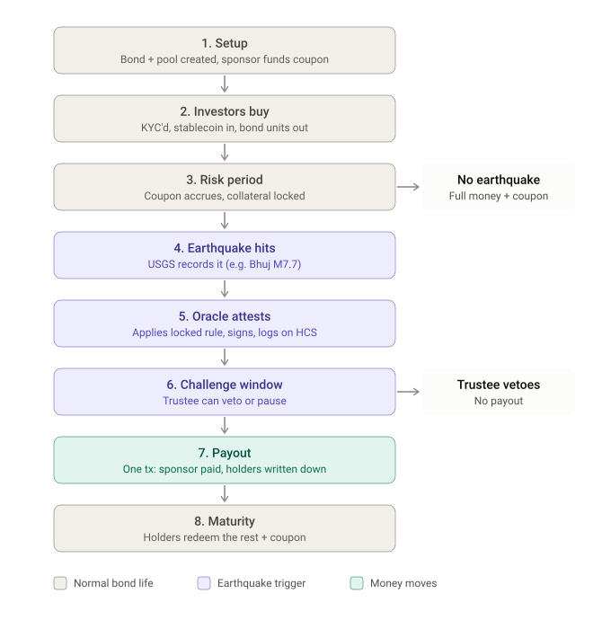

# Faultline

**A parametric earthquake catastrophe bond on Hedera.** Investors earn a coupon for taking earthquake risk. If a
USGS-reviewed earthquake crosses a preset threshold inside the insured zone, principal is written down automatically
and paid to the sponsor after a short challenge window. No loss adjuster, no claims process, and every step leaves an
on-chain and HCS audit trail.

> **Prototype.** Self-reviewed, not audited, not a regulated insurance or securities product. Do not use it with real
> money. What is testnet-verified and what is mock-tested: [`docs/STATUS.md`](docs/STATUS.md).

## Why

- Cat bonds move disaster risk from a sponsor (a government or an insurer) to investors. The market stood at
  **$65.5 billion outstanding at the end of Q3 2026**
  ([Artemis](https://www.artemis.bm/wp-content/uploads/2026/10/catastrophe-bond-ils-market-report-q3-2026-1.pdf)).
- Setting one up is expensive (SPV, trustee, calculation agent, reporting); for small and private deals the market
  already uses a lighter "cat bond lite" ([OECD, 2024](https://doi.org/10.1787/ab1e49ef-en)).
- **India has no sovereign cat bond or sovereign parametric cover** ([OECD, 2024](https://doi.org/10.1787/ab1e49ef-en)),
  yet Kutch is an active fault zone: the 2001 Bhuj earthquake was M7.7.

Sources and dates: [`docs/research/MARKET.md`](docs/research/MARKET.md).

## How it works

<p align="center">
  
</p>

The same flow at contract level:

```
 Sponsor ──fund coupon reserve──▶ FaultlinePool ◀──stablecoin── Investors (KYC'd)
                                      │  mints ATS bond units 1:1
 USGS record ─▶ Oracle: apply rule, sign EIP-712 ─▶ HCS topic (signed message, relayer pays)
                                      ▼
                        FaultlineTrigger.submit()  ── challenge window (trustee may veto / pause)
                                      ▼
                  window ends ─▶ anyone: execute() ─▶ Pool.applyLoss(L) ─▶ sponsor's payout claimable
                                      ▼
            maturity + grace ─▶ holder: redeem() + claim() = principal × (1 − L) + coupon
```

| Part | Hedera service | Job |
| --- | --- | --- |
| Bond | Asset Tokenization Studio (ATS v8) | security token, KYC, controller redemption; the pool is the only minter |
| Stablecoin | Token Service (HTS) | collateral, coupon reserve and every payout |
| Oracle log | Consensus Service (HCS) | public, ordered log of every signed oracle message |
| `FaultlineTrigger` | EVM contract | checks the EIP-712 attestation against `termsHash`; window, veto, pause, revisions, replay protection |
| `FaultlinePool` | EVM contract | one global loss index for all holders (O(1) write-down), coupon index, claims, supply guard |

**Example rule (Kutch, India):** box 22.5–24.5 N, 68.5–71.5 E; depth ≤ 70 km; USGS-reviewed moment magnitude; loss
linear from **M7.0 = 0 %** to **M8.0 = 100 %**. Bhuj 2001 (M7.7, `usp000a8ds`) → **70 % loss**. The terms are hashed
(RFC 8785 JCS + keccak256) into `termsHash` and fixed at issuance, so nobody can change the rule after investors buy in.

**Trust is bounded, not hidden:** the oracle is trusted, but a challenge window, trustee veto, pause, replay protection
and chain-bound EIP-712 signatures limit it. Roles, trust assumptions and the legal note:
[`docs/TRUST.md`](docs/TRUST.md).

## Proof on Hedera testnet (2026-11-05/06)

- **Full demo:** 34 transactions and 2 HCS attestations. A SYNTHETIC event was paused and vetoed, and its replay was
  rejected. The real Bhuj record went live through the oracle, HCS and keeper to L = 7000. Books closed at
  **501 = 500 deposits + 1 reserve**. One redemption was made through the dashboard with MetaMask. Both contracts are
  `exact_match` on Sourcify.
- **Smoke run:** 33/33 transactions, full lifecycle, books closed at 1,001 = 1,000 + 1.
- **Tests:** 436 Hardhat, 83 oracle (+1 opt-in), 99 web, 11 Playwright.

Evidence: [`docs/TESTNET-EVIDENCE.md`](docs/TESTNET-EVIDENCE.md) · ids: [`docs/DEPLOYMENTS.md`](docs/DEPLOYMENTS.md) ·
accounts: [`docs/ACCOUNTS.md`](docs/ACCOUNTS.md). Still mock-tested only: revisions, two events, the 100 % cap,
Superseded, D15 advisories on testnet and a pause after the deadline.

## Run it

```bash
npm run setup                  # npm ci in root, oracle/, web/, ops/
npm run check                  # compile, all tests, typechecks, web lint and build

npm run e2e:local              # 3 full lifecycles on a local chain (mock tokens)
npm run node                   # terminal 1: local Hardhat node
npm run dashboard:demo:local   # terminal 2: deploy a demo world on it
npm run web:dev                # terminal 3: dashboard at http://localhost:3000
```

**Testnet** (the owner sends every real transaction; keys live only in the Hardhat 3 keystore, never in a file):

```bash
cd ops && npx hardhat keystore set FLH_DEPLOYER_PRIVATE_KEY   # once per FLH_* key, see docs/ACCOUNTS.md
CHECK_KEYS=1 npm run demo:0                                   # preflight, sends nothing
npm run demo:1                                                # each phase 1–7: dry run first, sends nothing
EXECUTE=1 npm run demo:1                                      # then for real (owner only)
```

Every command: [`docs/COMMANDS.md`](docs/COMMANDS.md). `/issuer` launches a new bond from your own wallet (mock-tested
locally, testnet not yet verified, see [`docs/STATUS.md`](docs/STATUS.md)).

## Repository

| Path | Contents |
| --- | --- |
| `contracts/` | `FaultlinePool`, `FaultlineTrigger`, interfaces; `mocks/` for local tests |
| `test/` | Hardhat tests: pool, trigger, shared, e2e, security, invariant fuzz |
| `shared/` | EIP-712 types and `ts/` (JCS, terms, `termsHash`, `dataHash`, HCS message format) |
| `oracle/` | calculation agent and replay CLI; `fixtures/` (real Bhuj record, labelled SYNTHETIC records) |
| `web/` | Next.js dashboard: overview, investor, sponsor, trustee, replay, evidence, issuer |
| `ops/` | Hardhat 3 testnet scripts: smoke run, full demo, issuer helpers ([`ops/README.md`](ops/README.md)) |
| `scripts/` | local deploy, end-to-end and demo scripts |
| `docs/` | architecture, commands, evidence, status, trust, lessons, security, research |

Design and decision log: [`HANDOVER.md`](HANDOVER.md), [`docs/ARCHITECTURE.md`](docs/ARCHITECTURE.md).

## Not

- **Retail:** real cat bonds are sold to qualified institutional buyers.
- **Licensed:** there is no SPV, no insurance licence and no securities offering. A real deal needs a licensed special
  purpose insurer and a Rule 144A, Regulation D or Regulation S offering.
- **Faster claims adjustment:** parametric bonds already skip it. The value is cheaper structuring and a transparent,
  automatic, auditable lifecycle.

## License

MIT, see [`LICENSE`](LICENSE). Third-party notices are in [`NOTICE.md`](NOTICE.md). The license covers the code only.
