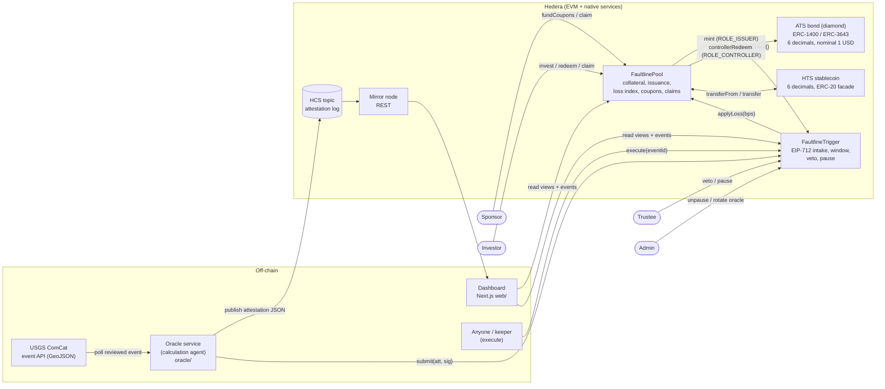
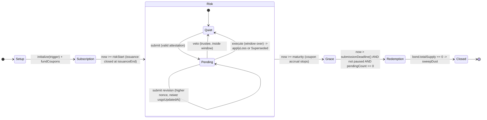
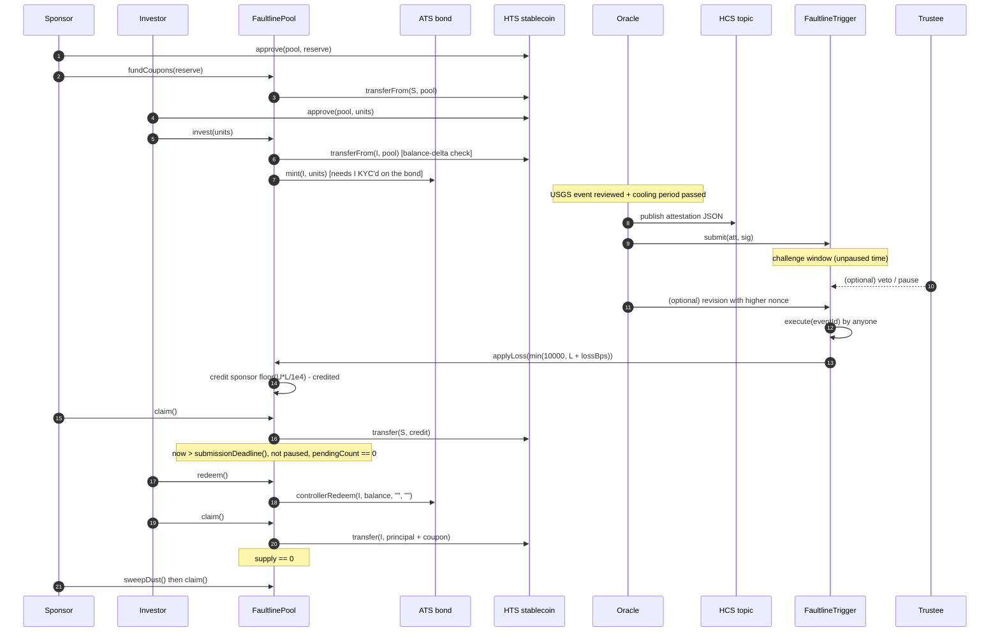

# Faultline architecture

Status: **FaultlinePool and FaultlineTrigger written and mock-tested (2026-10-26; local Hardhat only, never deployed).** Written 2026-10-25 from HANDOVER.md §6, §7, §12 and §15,
plus a read of the ATS v8.0.0 source (`~/Desktop/faultline-refs/asset-tokenization-studio`, commit
`be4f860`). Where this file and HANDOVER.md disagree, HANDOVER §15 wins until the owner approves a
change. The owner approved all items in [§12 Design decisions](#12-design-decisions-approved-2026-10-25)
on 2026-10-25; they are applied throughout this file.

Every change against HANDOVER §6 must be recorded in [§13 Change log](#13-change-log-against-handover-6).

---

## 1. Components



| Component | Trust | Holds funds | Holds ATS roles |
| --- | --- | --- | --- |
| FaultlinePool | code | yes (collateral + coupon reserve) | `ROLE_ISSUER`, `ROLE_CONTROLLER` on the bond |
| FaultlineTrigger | code | no | none |
| Oracle | **trusted** (single key), bounded by window, veto, pause, rotation | no | none |
| Trustee | trusted to veto only inside the window, and to pause | no | none on the bond |
| Admin | trusted to unpause and rotate the oracle | no | (separately: bond `DEFAULT_ADMIN_ROLE` holder is a trust assumption) |
| ATS bond | Hedera ATS v8, unmodified | — | — |
| HTS stablecoin | issuer's admin/KYC/freeze keys are a trust assumption; no wipe key | — | — |

---

## 2. Lifecycle



Time parameters (all immutable, unix seconds, checked in constructors):

`issuanceStart < issuanceEnd <= riskStart < maturity`, `0 < grace <= 365 days`, `0 < challengeWindow <= 30 days` (bounds: D17).

| Phase | Allowed | Blocked |
| --- | --- | --- |
| Setup | admin `initialize(trigger)` (once; HTS association), sponsor `fundCoupons` | invest |
| Subscription `[issuanceStart, issuanceEnd)` | `invest` if reserve covers the term; `fundCoupons` | submit (observedAt must be in risk period) |
| Risk `[riskStart, maturity]` | submit / veto / execute / pause; coupon accrues | invest, redeem |
| Grace `(maturity, submissionDeadline()]` | submit (for events observed in the risk period, not while paused), veto, execute | redeem, accrual |
| Redemption `> submissionDeadline()` (a pause begun before it keeps it closed; one begun after it does not, §4.2) | `redeem` once `pendingCount() == 0`; `execute` / `veto` of events still pending; `claim` | submit |
| Closed | `sweepDust` once bond supply is 0; `claim` | — |

`claim()` works in every phase.

---

## 3. FaultlinePool

Inherits OpenZeppelin `AccessControl`, `ReentrancyGuardTransient` (the storage `ReentrancyGuard` is deprecated in OZ 5.6); uses `SafeERC20`, `Math.mulDiv`. No `receive()`, no payable
functions, no HBAR handling.

### 3.1 Immutables (constructor)

| Name | Type | Meaning |
| --- | --- | --- |
| `stablecoin` | `IERC20` | HTS stablecoin (ERC-20 facade address), 6 decimals |
| `bond` | `IAtsBond` | ATS bond diamond, 6 decimals, nominal 1 USD |
| `sponsor` | `address` | receives write-down collateral, unused reserve and dust |
| `issuanceStart`, `issuanceEnd` | `uint64` | subscription window |
| `riskStart`, `maturity` | `uint64` | risk period; coupon accrues in `[riskStart, maturity]` |
| `grace` | `uint64` | seconds after maturity; submissions close and redemption opens at `trigger.submissionDeadline()` = `maturity + grace` + all paused time (D2) |
| `couponBps` | `uint16` | annual coupon on original notional, basis points |
| `cap` | `uint256` | max units (also set as the ATS bond max supply) |
| `minTicket` | `uint256` | minimum units per `invest` call |

The constructor takes one `Params` struct: the immutables above plus `admin` (gets `DEFAULT_ADMIN_ROLE`, calls
`initialize`). It reverts `ZeroAddress` for a zero admin, stablecoin, bond or sponsor, and `InvalidSchedule` unless
`issuanceStart < issuanceEnd <= riskStart < maturity`, `0 < grace <= 365 days` (D17), `couponBps`, `cap`, `minTicket` > 0 and both
tokens report 6 decimals. `lastAccrual` starts at `riskStart`.

### 3.2 State

| Name | Type | Meaning |
| --- | --- | --- |
| `trigger` | `address` | set once by `initialize` |
| `unitsIssued` (`U`) | `uint256` | total units minted by the pool; fixed after `issuanceEnd` |
| `unitsRedeemed` | `uint256` | total units burned by `redeem` |
| `appliedLossBps` (`L`) | `uint16` | cumulative loss, 0..10000, never decreases |
| `sponsorCredited` | `uint256` | always `floor(U * L / 10000)` |
| `couponReserve` | `uint256` | total funded by the sponsor |
| `couponIndex` | `uint256` | coupon per original unit, scaled 1e18 |
| `lastAccrual` | `uint64` | last checkpoint time (clamped to `[riskStart, maturity]`) |
| `principalPaid`, `couponPaid` | `uint256` | totals credited to holders at redemption |
| `claimable` | `mapping(address => uint256)` | pull balances |
| `totalClaimable` | `uint256` | sum of `claimable` |

Derived: `collateralLeft = U - sponsorCredited - principalPaid`; `couponReserveLeft = couponReserve - couponPaid`;
`outstanding = unitsIssued - unitsRedeemed`.

**Supply guard (D4, relaxed by D18).** `_checkSupply()` reverts with `SupplyMismatch(actual, expected)` when
`bond.totalSupply() > unitsIssued - unitsRedeemed`. Called in `invest`, `redeem` and `sweepExcess`
before any state change, so a foreign mint or an upward ATS balance adjustment stops payouts instead of
draining collateral. Supply below the books passes: any KYC'd holder can burn its own units through ATS with no
role (SEC-15), and that must not lock anyone.

### 3.3 Functions and access control

| Function | Who | Rules (all must hold) | Effect |
| --- | --- | --- | --- |
| `initialize(address trigger_)` | `DEFAULT_ADMIN_ROLE`, once | trigger non-zero; trigger's `pool()` == this | stores trigger; associates the pool with the HTS stablecoin (HIP-719 `associate()` on the token, or HTS `0x167`; see §8) |
| `fundCoupons(uint256 amount)` | sponsor only (D6) | `amount > 0`; `now < issuanceEnd` | KYC pre-check (D11) on the sponsor and the pool; pulls stablecoin with balance-delta check; `couponReserve += amount` |
| `invest(uint256 units)` | any KYC'd investor | initialized; `issuanceStart <= now < issuanceEnd`; `units >= minTicket`; `unitsIssued + units <= cap`; `couponReserve >= requiredReserve(unitsIssued + units)`; supply guard; KYC pre-check (D11) on `msg.sender` and the pool; incoming stablecoin balance delta == `units` | `bond.mint(msg.sender, units)`; `unitsIssued += units` |
| `applyLoss(uint16 cumulativeBps)` | `trigger` only | `now >= riskStart` (D12, `RiskPeriodNotStarted`); `appliedLossBps < cumulativeBps <= 10000`; `unitsRedeemed == 0` (defensive) | checkpoint coupon index; `L = cumulativeBps`; `credit = floor(U*L/10000) - sponsorCredited`; credit sponsor's `claimable` |
| `redeem()` | holder | `now > trigger.submissionDeadline()` (false while the trigger is paused, D2); `trigger.pendingCount() == 0`; supply guard; `b = bond.balanceOf(msg.sender) > 0` | checkpoint to `maturity`; `principal = floor(b*(10000-L)/10000)`; `coupon = floor(b*couponIndex/1e18)`; `bond.controllerRedeem(msg.sender, b, "", "")`; credit `principal + coupon` |
| `claim()` | anyone with a balance | `claimable[msg.sender] > 0`; KYC pre-check (D11) on `msg.sender` and on the pool itself (D17) | zero first, then `safeTransfer` (CEI + `nonReentrant`) |
| `sweepExcess()` (D3) | anyone | `now > trigger.submissionDeadline()`; `pendingCount() == 0`; supply guard | checkpoint to `maturity`; `owed = floor(outstanding*(10000-L)/10000) + floor(outstanding*couponIndex/1e18)`; credits `balance - totalClaimable - owed` (if > 0) to sponsor's `claimable`. Safe because the sum of per-holder floors ≤ the floor of the total. Repeatable: a second call finds 0 |
| `sweepDust()` | anyone | `now > trigger.submissionDeadline()`; `pendingCount() == 0`; `bond.totalSupply() == 0` | credits `stablecoin.balanceOf(this) - totalClaimable` to sponsor's `claimable` (final cleanup: rounding dust + stray transfers) |

Views: `effectiveValue(holder)` returns **two values `(principal, coupon)`**: `floor(b*(10000-L)/10000)` and
`floor(b*index/1e18)` with a view-only accrual to `min(now, maturity)`; `currentCouponIndex()`, `requiredReserve(units)`,
`collateralLeft()`, `couponReserveLeft()`, `isSolvent()` (invariant 1 in its always-true form, §5, with the index
accrued to maturity at the current `L`).

`requiredReserve(units) = ceil(units * couponBps * (maturity - riskStart) / (10000 * YEAR))`, `YEAR = 365 days`.

### 3.4 Coupon accrual

Checkpoint (`_accrue`), called inside `applyLoss` and `redeem`:

```
t  = clamp(now, riskStart, maturity)
dt = t - lastAccrual            (0 if t <= lastAccrual)
couponIndex += (10000 - L) * couponBps * dt * 1e18 / (10000 * 10000 * YEAR)
lastAccrual  = t
```

Because the checkpoint runs before `L` changes, a loss lowers accrual from the moment it is
**applied** (executed), not from the quake's `observedAt`. A loss executed during grace does not
change coupons at all (accrual already ended at maturity). This is the HANDOVER rule, stated plainly.

### 3.5 Events

`Initialized(address trigger)`, `CouponsFunded(address indexed sponsor, uint256 amount)`,
`Invested(address indexed investor, uint256 units)`,
`LossApplied(uint16 previousBps, uint16 newBps, uint256 sponsorCredit)`,
`Redeemed(address indexed holder, uint256 units, uint256 principal, uint256 coupon)`,
`Claimed(address indexed account, uint256 amount)`, `ExcessSwept(uint256 amount)`, `DustSwept(uint256 amount)`.

### 3.6 Custom errors

`AlreadyInitialized()`, `NotInitialized()`, `ZeroAddress()`, `TriggerMismatch()`, `OnlyTrigger()`,
`OnlySponsor()`, `InvalidSchedule()`, `SupplyMismatch(uint256 actual, uint256 expected)`, `ZeroAmount()`, `IssuanceClosed()`, `IssuanceNotOpen()`,
`BelowMinTicket(uint256 units, uint256 minTicket)`, `CapExceeded(uint256 requested, uint256 available)`,
`CouponReserveInsufficient(uint256 have, uint256 need)`,
`UnexpectedTransferAmount(uint256 expected, uint256 received)`,
`LossNotIncreasing(uint16 applied, uint16 requested)`, `LossOutOfRange(uint16 bps)`,
`RedemptionStarted()`, `RiskPeriodNotStarted()` (D12), `RedemptionNotOpen()`, `EventPending()`, `NothingToRedeem()`,
`NothingToClaim()`, `SupplyNotZero(uint256 supply)`, `NotKycForToken(address account)` (D11),
`HtsCallFailed(int64 responseCode)` (D11; also used when `associate()` returns neither 22 nor 194).

**KYC pre-check (D11).** `_requireKyc(account)` calls the HTS system contract
`IHederaTokenService(0x167).isKyc(address(stablecoin), account)` → `(int64 responseCode, bool kycGranted)`.
`responseCode != 22` → `HtsCallFailed(code)`; `!kycGranted` → `NotKycForToken(account)`. Reason: the HTS
ERC-20 facade reverts with **empty** revert data on a no-KYC transfer (spike S3), so without the check users
get a reasonless revert. Testnet simulation (mirror-node `eth_call`, 2026-10-25): KYC'd accounts → `(22, true)`;
an account never associated with the token → `(22, false)` (not 184); ≈ 24.6k gas. A frozen account still
fails with an empty revert (no freeze pre-check; see D11). The stablecoin must have a KYC key (behaviour of
`isKyc` on a token without one is not verified).

---

## 4. FaultlineTrigger

Inherits OpenZeppelin `AccessControl`, `EIP712`; uses `ECDSA`. Pause is custom (needs pause-time
accounting); OZ `Pausable` may be used for the flag plus the extra fields below.

### 4.1 Roles

| Role | Holder | Can |
| --- | --- | --- |
| `DEFAULT_ADMIN_ROLE` | admin | `unpause`, `setOracle`. **Cannot** grant or revoke `TRUSTEE_ROLE` (D17) |
| `TRUSTEE_ROLE` = `keccak256("TRUSTEE_ROLE")` | trustee(s) | `veto` (inside window, even while paused), `pause`; TRUSTEE_ROLE is its own admin (D17): trustees add a backup and remove each other |
| oracle (plain address, not a role) | calculation agent key | signs attestations; anyone may relay `submit` |

### 4.2 Immutables and state

| Name | Type | Meaning |
| --- | --- | --- |
| `pool` | `address` immutable | the one pool this trigger serves |
| `termsHash` | `bytes32` immutable | hash of the canonical trigger terms JSON (§6.3) |
| `challengeWindow` | `uint64` immutable | seconds of **unpaused** time between submit and execute |
| `riskStart`, `maturity`, `grace` | `uint64` immutable | read from the pool in the constructor |
| `oracle` | `address` | current signer |
| `events` | `mapping(bytes32 => EventRecord)` | per eventId |
| `pendingCount` | `uint256` | number of events in `Pending` |
| `paused`, `pauseStart`, `totalPausedSeconds` | `bool`, `uint64`, `uint64` | pause clock |

`EventRecord { Status status; uint16 lossBps; uint16 magnitudeX100; uint64 observedAt;
uint64 usgsUpdatedAt; uint64 nonce; bytes32 dataHash; uint64 windowStart; }`

`enum Status { None, Pending, Vetoed, Executed, Superseded }` — `Vetoed`, `Executed`, `Superseded`
are terminal and permanent.

`effectiveTime() = (paused ? pauseStart : block.timestamp) - totalPausedSeconds`.

`submissionDeadline() = maturity + grace + totalPausedSeconds + (paused ? block.timestamp - pauseStart : 0)`
(D2). Every second the trigger spends paused moves the submission cutoff — and therefore the opening
of redemption — one second later, so a pause can never make a legitimate quake miss the cutoff, and a
late attestation can still never arrive after a holder has redeemed. A pause that starts **before** the
deadline makes the deadline move with the clock, so `redeem` and the sweeps stay closed until the admin
unpauses. A pause that starts **after** the deadline has passed does not close redemption again: the
deadline then stays `deadline_at_pause_start + (now - pauseStart)`, which is always `< now`, and after the
unpause it is `<= now`, so submissions never reopen either (FaultlineTrigger tests must cover both cases).
Window is complete when `effectiveTime() >= windowStart + challengeWindow`.

### 4.3 Functions

| Function | Who | Rules | Effect |
| --- | --- | --- | --- |
| `submit(Attestation att, bytes sig)` | anyone (relays the oracle's signature) | checked **in this order**: **not paused** (D2, `IsPaused`); `now <= submissionDeadline()` (`SubmissionClosed`); `ECDSA.tryRecover(_hashTypedDataV4(hash(att)), sig) == oracle` (`InvalidSignature`, also for high-s or non-65-byte signatures); `now <= att.deadline` (`AttestationExpired`); `riskStart <= att.observedAt <= min(now, maturity)` (`ObservedOutsideRiskPeriod`); `att.termsHash == termsHash` (`TermsMismatch`); `1 <= att.lossBps <= 10000` (`LossOutOfRange`); status is `None`, **or** `Pending` with `att.nonce > stored.nonce` and `att.usgsUpdatedAt > stored.usgsUpdatedAt` (`StaleRevision`), a terminal status reverts `EventFinalised(eventId, status)`; `pool.appliedLossBps() < 10000` (`FullyWrittenDown`) | `None → Pending` (`pendingCount++`) or `Pending → Pending` (revision; may lower the loss); store fields; `windowStart = effectiveTime()` |
| `veto(bytes32 eventId)` | `TRUSTEE_ROLE` | status `Pending`; window not complete; **allowed while paused** | `Pending → Vetoed`; `pendingCount--` |
| `execute(bytes32 eventId)` | anyone | not paused; status `Pending`; window complete | `pendingCount--`; `L = pool.appliedLossBps()`; if `L == 10000` → `Superseded` (nothing left to lose, no revert); else → `Executed` and `pool.applyLoss(min(10000, L + stored.lossBps))` (D1) |
| `pause()` | `TRUSTEE_ROLE` | not paused | `paused = true; pauseStart = now` |
| `unpause()` | `DEFAULT_ADMIN_ROLE` | paused | `totalPausedSeconds += now - pauseStart; paused = false` |
| `setOracle(address)` | `DEFAULT_ADMIN_ROLE` | non-zero | rotates the signer; pending events stay valid (already verified) |

Views: `effectiveTime()`, `submissionDeadline()`, `windowEndsAt(eventId)` (in effective time), `windowRemaining(eventId)`,
`getEventRecord(eventId)` (renamed from `getEvent`, see §13), `hashAttestation(att)` (EIP-712 digest, for the oracle and tests),
`pendingCount()`, `ATTESTATION_TYPEHASH()` (constant, also in IFaultlineTrigger).

### 4.4 Events

`AttestationSubmitted(bytes32 indexed eventId, uint64 nonce, uint16 lossBps, uint16 magnitudeX100,
uint64 observedAt, uint64 usgsUpdatedAt, bytes32 dataHash, uint64 windowStart)`,
`AttestationRevised(bytes32 indexed eventId, uint64 oldNonce, uint64 newNonce, uint16 oldBps, uint16 newBps)`,
`EventVetoed(bytes32 indexed eventId, address indexed trustee)`,
`EventExecuted(bytes32 indexed eventId, uint16 lossBps, uint16 newCumulativeBps)`,
`EventSuperseded(bytes32 indexed eventId, uint16 lossBps)`,
`TriggerPaused(address indexed by)`, `TriggerUnpaused(address indexed by, uint64 pausedFor)`,
`OracleRotated(address indexed oldOracle, address indexed newOracle)`.

### 4.5 Custom errors

`InvalidSignature()`, `AttestationExpired(uint64 deadline)`, `ObservedOutsideRiskPeriod(uint64 observedAt)`,
`TermsMismatch(bytes32 got)`, `LossOutOfRange(uint16 bps)`, `FullyWrittenDown()`,
`SubmissionClosed()`, `EventFinalised(bytes32 eventId, Status status)`, `StaleRevision()`,
`NotPending(bytes32 eventId)`, `WindowOpen(uint64 endsAt)`, `WindowClosed()`, `IsPaused()`,
`NotPaused()`, `ZeroAddress()`, `InvalidSchedule()`.

---

## 5. Write-down maths and invariants

```
sponsorCredit_k = floor(U * C_k / 10000) - floor(U * C_{k-1} / 10000)
redeemable(b)   = floor(b * (10000 - L) / 10000)
coupon(b)       = floor(b * couponIndex / 1e18)
```

Rounding always goes against the holder. Sum of per-holder floors `<= floor(sum)`, so the pool can
never owe more than it holds.

**Invariants (tests must assert after every step of every random sequence):**

1. `stablecoin.balanceOf(pool) >= collateralLeft + couponReserveLeft + totalClaimable` (until the first sweep); always `balanceOf(pool) >= totalClaimable + floor(outstanding*(10000-L)/10000) + floor(outstanding*maxCouponIndex/1e18)`, where `outstanding = min(unitsIssued - unitsRedeemed, bond.totalSupply())` (D18) and `maxCouponIndex` is the index if accrual continued to maturity at the current `L`.
2. `collateralLeft >= sum over unredeemed holders of redeemable(balance)`.
3. Sponsor credit depends only on the final `L`: `sponsorCredited == floor(U*L/10000)` for any sequence of events that reaches `L`.
4. `bond.totalSupply() <= unitsIssued - unitsRedeemed` (enforced on-chain by the supply guard, D4 and D18), and `==` when nobody burned units through ATS.
5. No sequence of transfers, vetoes, pauses or replays lets a holder receive more than `redeemable(balance) + coupon(balance)`.
6. `appliedLossBps` never decreases; `appliedLossBps <= 10000`.
7. `couponReserveLeft >= sum over unredeemed holders of coupon(balance)`; `couponIndex` at maturity `<= couponBps * term * 1e18 / (10000 * YEAR)`.
8. `pendingCount == number of events with status Pending`; terminal statuses never change.
9. `pendingCount > 0` or `now <= trigger.submissionDeadline()` (always true while paused) ⇒ `redeem`, `sweepExcess` and `sweepDust` revert.
11. No `submit` succeeds after the first successful `redeem` (the submit cutoff and the redemption opening are the same moving `submissionDeadline()`).
10. `L = min(10000, sum of lossBps of Executed events)`; vetoing one pending event never changes another event's loss.

---

## 6. Oracle and attestation

### 6.1 EIP-712

Domain: `name = "FaultlineTrigger"`, `version = "1"`, `chainId` (31337 local, 296 testnet, 295 mainnet),
`verifyingContract` = the trigger. One trigger per bond, so a signature is bound to one bond.

```
Attestation(
  bytes32 eventId,        // keccak256(utf8(USGS preferred event id))
  uint16  lossBps,        // loss of THIS event, 1..10000 (D1); the trigger aggregates
  uint16  magnitudeX100,  // round(mag * 100) (§6.2; USGS mag is a JSON float)
  uint64  observedAt,     // USGS properties.time / 1000 (origin time, seconds)
  uint64  usgsUpdatedAt,  // USGS properties.updated / 1000
  uint64  nonce,          // strictly increasing per eventId
  bytes32 termsHash,      // must equal the trigger immutable
  bytes32 dataHash,       // keccak256 of the canonical USGS record (6.4)
  uint64  deadline        // unix seconds; submit must happen before it
)
```

### 6.2 Acceptance rule (all must hold)

`properties.status == "reviewed"`; `properties.type == "earthquake"`; `properties.magType` in the
moment-magnitude list from the terms (owner-approved: `mww, mwc, mwb, mwr, mw`, see
docs/reference/usgs.md); epicentre inside the box (`geometry.coordinates = [lon, lat, depthKm]`);
`depthKm <= maxDepthKm`; cooling period passed (placeholder 6 h) on the real clock: live `now - observedAt >= coolingPeriod`,
replay `now - floor(time/1000) >= coolingPeriod` (D14); event not already
used under **any** of its associated ids (`properties.ids`), see §12 D8.

Payout: linear from `floorMag` (0 bps) to `ceilMag` (10000 bps), **7.0 → 8.0** (D13), rounded
down to whole bps, computed in integer maths from `magnitudeX100`:
`lossBps = min(10000, (magX100 - 700) * 10000 / 100)` for `magX100 > 700`, else no event. `magnitudeX100` is
`round(mag * 100)` (USGS `mag` is a float: `8.2 * 100` is `819.9999999999999`, so a floor would give 819; `7.7 * 100` happens to be exactly 770, and between 6.00 and 8.00 floor and round never differ for two-decimal magnitudes). Bhuj M7.7 → 7000 bps.

### 6.3 Terms file and `termsHash`

`oracle/terms/<bond>.json`, canonicalised with RFC 8785 (JCS), `termsHash = keccak256(bytes)`:
version, box `{minLat, maxLat, minLon, maxLon}`, `maxDepthKm`, `magTypes[]`, `floorMagX100`,
`ceilMagX100`, `coolingPeriodSec`, `aggregation: "sum-capped-10000"` (D1), `mode: "live" | "replay"` and
`timeOffsetSec` (D10; 0 when live), `source` (`"USGS ComCat"`).

### 6.4 `dataHash`

keccak256 of the JCS-canonicalised subset of the USGS feature: `id`, `properties.{time, updated,
mag, magType, status, type, ids, net, code}`, `geometry.coordinates`. Volatile fields (`felt`, `cdi`,
`sig`, `url`, `detail`) are excluded so `dataHash` changes only when the scientific record changes.

### 6.5 HCS message (one per attestation, ≤ 1024 bytes)

```json
{
  "v": 1,
  "kind": "faultline.attestation",
  "chainId": 296,
  "trigger": "0x…",
  "mode": "live",
  "timeOffsetSec": 0,
  "attestation": { "eventId": "0x…", "lossBps": 5000, "magnitudeX100": 700,
                   "observedAt": 0, "usgsUpdatedAt": 0, "nonce": 1,
                   "termsHash": "0x…", "dataHash": "0x…", "deadline": 0 },
  "signature": "0x…",
  "usgsId": "<preferred id>"
}
```

`mode` and `timeOffsetSec` are copied from the bond's terms (D14), so a reader sees at once that a replayed attestation
is not a live quake. The bytes on HCS are `utf8(JCS(message))`, one ≤ 1024-byte chunk (shared/ts/hcsMessage.ts).

**Advisory message (D15)** — published when a PENDING event stops passing the rule:
`{"v":1,"kind":"faultline.advisory","chainId","trigger","eventId","usgsId","reason","dataHash","action":"trustee should veto","signature"}`;
`reason` is one of `status | type | magType | box | depth | belowFloor | deleted | not-found`; `dataHash` is the new
record's hash, `null` when the record is gone.

**Signatures inside the payload (D16).** An attestation message carries the oracle's EIP-712 signature (the one the
trigger checks); an advisory carries an EIP-191 signature by the oracle key over `utf8(JCS(message without
"signature"))`. `recoverMessageSigner` / `verifyMessageSigner` (shared/ts/hcsMessage.ts) check both kinds; a reader
compares the result with `trigger.oracle()`. **The on-chain trigger, not HCS, is the source of truth.**

**Topic keys (D16, used in step 9):** submit key = the oracle signer key (the oracle pays nothing and needs
no HBAR); admin key = the TRUSTEE key; the relayer account (separate, small, funded; keystore
`FLH_RELAYER_PRIVATE_KEY`) pays every HCS and EVM fee and is the topic's auto-renew account. The admin key can change
the submit key and delete the topic, so rotating the oracle then needs the trigger admin (`setOracle`) AND the trustee
(`TopicUpdate` of the submit key). Spike S7 tests this layout on testnet.
No personal data on HCS. Mock mode writes the same JSON lines to `oracle/.hcs-mock/<topic>.jsonl`.

### 6.6 Revision loop

While an event is Pending the oracle re-reads the USGS record (every `pendingPollSec`, D15). If `updated` changes and the
computed values change, it signs a new attestation with `nonce + 1` and the new `usgsUpdatedAt`, publishes to
HCS, and submits. The window restarts. After execution there is no clawback.

**Revision rule (owner approved 2026-10-27): a revision is sent ONLY when `lossBps` changes.** For a PENDING event:
- record still passes the rule and `lossBps` is unchanged (even if `magnitudeX100`, `observedAt`, `usgsUpdatedAt` or
  `dataHash` changed) → no revision, no HCS message, the challenge window is NOT restarted; the oracle records the new
  values, the new `dataHash` and the time seen in its ledger (`notes`), so the history is kept;
- `lossBps` changed (and `usgsUpdatedAt` is newer than the chain's) → revision with `nonce + 1` and the new values;
  if `usgsUpdatedAt` is not newer, no revision is possible (`StaleRevision`) and the oracle logs it;
- record no longer passes the rule, including `observedAt` moving outside `[riskStart, maturity]` → D15 advisory. A record whose ids overlap a known event (D8)
keeps the ORIGINAL eventId even when USGS changed the preferred id. Full decision table: oracle/src/decision.ts.

---

## 7. Data flow (happy path)



---

## 8. Hedera-specific requirements

1. **Stablecoin is an HTS token.** The pool must be associated before receiving it: call HIP-719
   `IHRC719(token).associate()` from the pool (or HTS system contract `0x167`
   `associateToken(address(this), token)`), inside `initialize`. The token's KYC key holder must
   grant KYC to the pool, sponsor and every investor before the first transfer. Order is fixed:
   **associate → KYC → fund** (KYC before association fails with 184, spike S3). A second `associate()`
   returns 194 without reverting but costs as much gas (~730k), so call it once. On failure the facade
   reverts with empty data; the pool pre-checks KYC through `0x167` `isKyc` (D11). Local tests: `MockHTS`
   placed at `0x167` with `setCode`, reading KYC/freeze flags from `MockUSD`.
2. **No wipe key** on the MVP stablecoin (a wipe could drain the pool). Freeze key is a stated trust
   assumption. No custom fees (balance-delta check catches them anyway).
3. **ATS v8 setup order** for a fresh bond: deploy via factory `0.0.9213391` (Luhn-valid ISIN,
   6 decimals, nominal 1 USD, max supply = `cap`); grant `ROLE_SSI_MANAGER`; `addIssuer(issuer)`;
   grant `ROLE_KYC`; `grantKyc(account, vcId, validFrom, validTo, issuer)` for each investor; grant
   the pool `ROLE_ISSUER` and `ROLE_CONTROLLER`; remove `ROLE_ISSUER` and `ROLE_AGENT` from everyone
   else (`ROLE_AGENT` can also mint and `controllerRedeem`); ensure nobody holds
   `ROLE_ADJUSTMENT_BALANCE`. The bond must be controllable (`isControllable() == true`), single
   partition, never paused.
4. **Bond functions used** (ATS v8 source, testnet check pending): `mint(address,uint256)` (also
   `issue(address,uint256,bytes)`), both need caller `ROLE_ISSUER` or `ROLE_AGENT`, recipient KYC
   `GRANTED`, token unpaused, within max supply; `controllerRedeem(address,uint256,bytes,bytes)` needs
   `ROLE_CONTROLLER` or `ROLE_AGENT`, token unpaused and controllable, **no KYC check on the holder**,
   **no maturity check**; `balanceOf`, `totalSupply`, `decimals`.
5. **No `msg.value` in constructors**; fund with a normal call after deploy. HBAR inside the EVM is
   tinybar (8 decimals); the JSON-RPC relay speaks weibar (18). The MVP pool and trigger hold no HBAR.
6. **EVM target `cancun`** (OZ 5.6 needs `MCOPY`; ATS v8 also targets cancun). Verified: Hedera
   supports Cancun opcodes since v0.50 (docs/reference/hedera.md §2).
7. **Admin transactions go through scripts** (ethers + Hashio), not MetaMask (Hashio rejected a
   large-gas MetaMask call before).
8. **Schedule Service (`0x16b`)** is a stretch goal only (keeper fallback). Max 62 days ahead,
   non-reverting response codes (22 = success), probably no scheduling from a scheduled call.
9. **Gas:** 15M gas per transaction (verified, Hedera gas docs); unused gas fully refunded; every
   function here is O(1).
10. **Oracle accounts (D16):** the oracle signer key has no Hedera account and holds no HBAR; it signs attestations,
   advisories and (as the topic's submit key) HCS messages. A separate relayer account pays HCS and EVM fees and relays
   `submit`/`execute`. Spike S7 checks submit key ≠ payer on testnet (U16).

---

## 9. Trust assumptions (for the README)

Oracle key (bounded by window, veto, pause, rotation); trustee veto power (only inside the window,
and a veto is permanent for that event); a pause also delays redemption by its length, and only the
admin can end it, with no maximum length: a lost admin key during a pause begun before the deadline locks redemption and
both sweeps for ever, and with a pending event past its window it locks them even for a pause begun after the deadline
(SEC-19, accepted, no contract change; production needs the trigger admin in a multisig); since D17 the admin can no longer remove a trustee, so a rogue trustee who re-pauses repeatedly can
be removed only by another trustee (keep a backup trustee in separate custody); losing every trustee key removes veto
and pause for good; the trigger admin can rotate the oracle but cannot touch the trustees (D17); finality is the FIRST
execute after the window: a revision landing first restarts the window (SEC-06);
on-chain `magnitudeX100` / `observedAt` / `dataHash` can lag the latest USGS record while the loss is unchanged (§6.6; the
oracle's ledger keeps the latest values); finality at the end of the window, no clawback after a
later USGS revision (**residual risk, D15:** the oracle re-checks a pending event's record every `pendingPollSec` and
publishes an advisory at once if it stops passing the rule, but a USGS revision that arrives AFTER the window has ended
cannot undo an executed write-down); single mint authority (bond `DEFAULT_ADMIN_ROLE` holder could re-grant
`ROLE_ISSUER` or adjust balances upward, which the D4 supply guard turns into a redemption LOCK rather than a drain
(accepted, SEC-02: hold the bond `DEFAULT_ADMIN_ROLE` in a multisig or timelock in production), except a foreign mint up to
the amount holders burned, which the guard no longer sees (D18); it could also pause the bond, or grant itself
CONTROLLER and force-transfer holders' units, which D4 cannot see); holders may burn their own units through ATS with no
role: that value goes to the sponsor through `sweepDust`, never to another holder (D18); D9 does not stop holds: a holder
can create one with no role and no KYC, held units leave `balanceOf` but stay in `totalSupply`, and the harm stays with
that holder (SEC-21); stablecoin admin keys (revoking or freezing the
pool's KYC stops every payout until restored; claim reports `NotKycForToken(pool)`, D17); ATS
balance ≠ effective value after a write-down; holders can sell during the window (buyer inherits
the loss); collateral earns no yield; sponsor pre-funds the full-term coupon.

---

## 10. Unverified assumptions (must be checked; owner of each check in brackets)

| # | Assumption | Source so far | Check |
| --- | --- | --- | --- |
| U1 | ~~ATS v8 bond mint is `mint(address,uint256)` / `issue(address,uint256,bytes)`~~ **verified on testnet** (2026-10-25): both work for a contract holding `ROLE_ISSUER`; an EOA without it reverts `AccountHasNoRoles` (`0x90e55392`); txs in docs/TESTNET-EVIDENCE.md | spike S1 steps 5–6 | done |
| U2 | ~~`controllerRedeem` reverts when the bond is paused~~ **verified on testnet** (2026-10-25): `controllerRedeem` and `mint` revert `IsPaused()` (`0x1309a563`) while paused, work again after `unpause()`; confirms "never pause the bond"; txs in docs/TESTNET-EVIDENCE.md | spike S2 | done |
| U3 | ~~`controllerRedeem` works after the ATS bond maturity date and on a holder without KYC~~ **verified on testnet** (2026-10-25): burned 1 unit from the investor after `revokeKyc`, and 1 unit after `maturityDate`; txs in docs/TESTNET-EVIDENCE.md | spike S1 steps 8–9 | done |
| U4 | ~~ATS bond can be created with nominal 1 USD and 6 decimals on the v8 factory~~ **verified on testnet** (2026-10-25): spike bond: `decimals()` 6, `getNominalValue()` 100 with 2 decimals; this project's bonds FLSMK `0.0.11329898` and FLDMO `0.0.11330397` have the same shape (docs/DEPLOYMENTS.md) | spike S1 step 1 | done |
| U5 | ~~A contract can associate with an HTS token via HIP-719 `associate()`, receive it via ERC-20 `transferFrom`, and pay out via `transfer`~~ **verified on testnet** (2026-10-25): associate → 22 (second call returns 194, no revert); `transferFrom` and `transfer` return `true` once associated + KYC'd; failures revert with empty data; txs in docs/TESTNET-EVIDENCE.md | spike S3 | done |
| U6 | ~~HTS KYC must be granted to the pool contract's account~~ **verified on testnet** (2026-10-25): without it `transferFrom` into the vault fails with 176 `ACCOUNT_KYC_NOT_GRANTED_FOR_TOKEN`; KYC itself needs an association first (184 otherwise) | spike S3 | done |
| U7 | ~~Hedera EVM accepts `cancun` bytecode~~ **verified**: Cancun opcodes live since v0.50, Hedera now on Pectra (docs/reference/hedera.md §2); **confirmed in practice** by the smoke run (2026-10-26): FaultlinePool (`ReentrancyGuardTransient`, TSTORE) and FaultlineTrigger deployed and ran | Hedera docs + smoke run | done |
| U8 | ~~HCS topic create/publish/read via SDK + mirror node works with the owner's account~~ **verified on testnet** (2026-10-25): spike topic, the §6.5 message (636 bytes, one chunk) read back byte-for-byte equal 3.14 s after submit; a non-submit-key signer gets `INVALID_SIGNATURE`. This project's topic `0.0.11330395` carries two oracle messages (docs/TESTNET-EVIDENCE.md) | spike S5 | done |
| U9 | ATS coupon entitlement / snapshot can support interim coupons | untested | spike S6 (stretch) |
| U10 | Official codes 373/374 suggest recursive self-scheduling **is** supported (≈4M times) and only a second schedule in the same operation after a recursive one fails | `HederaResponseCodes.sol` | spike S4 (stretch) |
| U11 | USGS `status`, `magType` meanings and `ids` behaviour on event merges | not yet read | docs/reference/usgs.md |
| U12 | USGS turns big quakes `reviewed` well within `grace` | not checked | pick `grace` after reading USGS docs; oracle prompt |
| U13 | ATS `balanceOf` returns free balance only (locked / held / cleared units excluded) | not checked | read ATS ERC20 facet; affects `redeem` and `sweepDust` |
| U14 | Contracts created via EVM on Hedera have unlimited auto-association ~~(so explicit associate may be optional)~~ **first half verified, conclusion false** (2026-10-25): an `eth_sendRawTransaction` contract gets `max_automatic_token_associations` -1, but a KYC token still needs an explicit associate, because `TokenGrantKyc` requires an association | spike S3 | done |
| U16 | An HCS topic whose submit key (oracle) differs from the fee payer (relayer) accepts messages signed by both and rejects the payer alone; the admin key (trustee) can rotate the submit key | **verified on testnet** (spike S7, 2026-10-27): relayer + oracle → SUCCESS, relayer alone → INVALID_SIGNATURE at consensus, trustee admin key rotated the submit key away and back. The same layout carries this project's topic `0.0.11330395` (relayer pays, oracle = submit key, trustee = admin key) | done |
| U15 | HTS `isKyc(token, account)` via `0x167` returns `(22, true)` for KYC'd accounts and `(22, false)` for a never-associated account, ≈ 24.6k gas | simulated on testnet (2026-10-25); **`(22, true)` path verified from on-chain txs** in the smoke run (2026-10-26): `fundCoupons`, `invest`, `claim` passed the D11 pre-check through the real `0x167`. The `(22, false)` → `NotKycForToken` path is still simulation only | done for KYC'd accounts |

---

## 11. Repository map (target)

```
contracts/
  FaultlinePool.sol
  FaultlineTrigger.sol
  interfaces/ IAtsBond.sol  IFaultlinePool.sol  IFaultlineTrigger.sol  IHRC719.sol  IHederaTokenServiceLite.sol  IHederaScheduleService.sol
  mocks/      MockUSD.sol  MockBond.sol  MockHTS.sol (at 0x167)  MockTrigger.sol  MockHSS.sol (at 0x16b, stretch)
test/          pool.*.ts  trigger.*.ts  invariants.*.ts  helpers/
scripts/       deploy-local.ts  e2e-local.ts  testnet/*
oracle/src/    usgs.ts  rule.ts  terms.ts  attest.ts  hcs.ts  submit.ts  cli.ts
oracle/fixtures/ synthetic-*.json (labelled synthetic)
web/src/app/   investor / sponsor / trustee / replay
```

---

## 12. Design decisions (approved 2026-10-25)

Found while writing this file, approved by the owner in the prep session. Already applied above.

| ID | Problem found | Decision |
| --- | --- | --- |
| D1 (bug, high) | A signed *cumulative* loss is wrong when two events are pending: if quake A (5000) and quake B (5000) are both pending and the oracle signs B as `0 + 5000`, executing A first makes B `Superseded` and the second quake pays nothing; if it signs B as `10000` and A is vetoed, B overpays | Oracle signs a **per-event `lossBps`**. `execute` applies `min(10000, L + lossBps)`. Sponsor credit is still computed from cumulative `L`, so it stays path-independent. Revisions replace a pending event's `lossBps`. `Superseded` now only means `L == 10000`. Terms state `aggregation: "sum-capped-10000"` |
| D2 (gap) | Spec silent on `submit` while paused | `submit` reverts while paused (pause is the emergency stop for a compromised oracle key). `veto` still works while paused; `execute` does not. **Refined 2026-10-25:** the submission cutoff is `submissionDeadline() = maturity + grace + total paused time` (including a pause still running), so a pause cannot make a legit quake miss the cutoff. Redemption and the sweeps open only after the same `submissionDeadline()`; a pause that starts before the deadline keeps redemption closed, one that starts after it does not (§4.2, wording corrected 2026-10-27, SEC-05). A late attestation can never land after someone has redeemed |
| D3 (gap) | `sweepDust` needs bond supply 0, so one holder who never redeems locks the sponsor's unused reserve for ever | Add `sweepExcess()` after `submissionDeadline()` with no pending event: sponsor gets `balance − totalClaimable − owed(outstanding)`. Keep `sweepDust` for the final cleanup |
| D4 (security, high) | `redeem` pays from `bond.balanceOf`; a foreign mint (re-granted `ROLE_ISSUER`, any `ROLE_AGENT`, ATS balance adjustment) would let someone redeem collateral they never paid for | On-chain supply guard in `invest`, `redeem`, `sweepExcess`: revert `SupplyMismatch` unless `bond.totalSupply() == unitsIssued − unitsRedeemed` (**relaxed to `>` by D18**). Deploy script asserts `ROLE_ISSUER` members == [pool], `ROLE_AGENT` == [], `ROLE_ADJUSTMENT_BALANCE` == [] |
| D5 (wiring) | Pool and trigger depend on each other | Deploy pool → deploy trigger(pool, termsHash, window, oracle, admin, trustee), which copies the schedule from the pool → admin calls `pool.initialize(trigger)` once (also HTS association) |
| D6 (clarify) | Who funds coupons | Sponsor only, before `issuanceEnd` |
| D7 (doc) | Coupon cut timing | Coupon drops from when a loss is **executed**, not from `observedAt`; stated in the README |
| D8 (oracle) | USGS can merge events and change the preferred id → same quake under two eventIds (worse with additive D1) | Oracle keeps a ledger of every id in `properties.ids` it has attested and refuses overlaps; trustee veto is the backstop. No contract change |
| D9 (ATS) | ATS locks / holds / clearing keep units out of the free balance | Never grant lock, hold or clearing roles on the Faultline bond; document. D3 removes the sweep lock-up |
| D10 (demo) | A historical quake (Bhuj 2001, `usp000a8ds`) can never satisfy `riskStart <= observedAt <= now` on a bond issued in 2026 | **Replay terms**: the demo bond's terms JSON has `"mode": "replay"` and a fixed `timeOffsetSec`; the oracle signs `observedAt = floor(usgsTime/1000) + timeOffsetSec` (same offset for `usgsUpdatedAt`) and keeps the real `dataHash`. `termsHash` covers the mode, so a production bond (`"mode": "live"`) can never accept a replay attestation. Dashboard shows a REPLAY badge. Works on local and testnet. No contract change |
| D11 (UX/safety) | The HTS facade reverts with empty data on a no-KYC transfer (S3), so `invest`, `fundCoupons` and `claim` would fail without a reason | Owner approved (a): before each stablecoin transfer the pool calls `0x167` `isKyc(token, account)` and reverts with `NotKycForToken(account)` (or `HtsCallFailed(code)`). Checks: sponsor + pool in `fundCoupons`, investor + pool in `invest`, recipient + pool in `claim` (pool added by D17). Freeze is not pre-checked (would be the same pattern with `isFrozen`; not approved yet) |
| D12 (defence in depth, owner approved 2026-10-26) | The pool did not itself stop an `applyLoss` before issuance closes; the real trigger cannot do it (`observedAt >= riskStart`), but if it ever did, a later `invest` would break `sponsorCredited == floor(U*L/10000)` | `applyLoss` reverts `RiskPeriodNotStarted()` while `now < riskStart`; since `riskStart >= issuanceEnd` this also covers the issuance window, and it matches the trigger's own rule |
| D13 (parameters, owner approved 2026-10-26) | Box, curve, depth, coupon and schedule were placeholders | Values in the table below. Bhuj (`usp000a8ds`) re-checked on the live USGS API on 2026-10-26: M7.7, `mwc`, `reviewed`, depth 16 km, 23.419 N 70.232 E; same `dataHash` fields as the saved fixture |
| D14 (replay demo, owner approved 2026-10-26) | In replay mode the shifted `observedAt` sits in the bond's risk period, so a 6 h cooling period measured on that clock would hold a testnet replay for 6 h (the risk period is ~20 min) | `checkAcceptance` in replay mode measures cooling on the **real clock**: `realNowSec - floor(time/1000) >= coolingPeriodSec` (live unchanged; same inclusive boundary). A replayed event is decades old, so the demo does not exercise the cooling period. Replay is allowed only on chainIds **31337 and 296**: `buildAttestation` (shared/ts) refuses replay terms elsewhere (295 mainnet, 297 previewnet, …) and every deploy script refuses to deploy a trigger with replay terms elsewhere (`assertReplayAllowed`). This is an **off-chain guard**: no contract change; on chain the mode is only visible through `termsHash`. The HCS message carries `mode` and `timeOffsetSec` (§6.5); the dashboard REPLAY badge (D10) stays |
| D15 (owner approved 2026-10-27, with conditions) | A PENDING event can later fail the rule (USGS moves it out of the box, below the floor, deeper than the limit, another magType or status, or deletes it); the oracle cannot revise it to 0 (`lossBps >= 1`) | The oracle logs a loud ERROR, publishes a signed `faultline.advisory` HCS message (reason, eventId, usgsId, the new record's dataHash, `"action":"trustee should veto"`) and submits NOTHING; the veto stays with the trustee. Pending events are re-checked on their own fast loop for the whole window (`pendingPollSec`: 10 s on the demo profile, minutes on a production window) and the advisory goes out at once; one advisory per (reason, dataHash). A revision after the window is a residual risk (§9). No contract change |
| D16 (owner approved 2026-10-27, with conditions) | Who signs and who pays on HCS | Topic submit key = oracle signer key; admin key = TRUSTEE key; a separate small relayer account (`FLH_RELAYER_PRIVATE_KEY`, `0.0.11329581`) pays HCS + EVM fees; the oracle signer needs no HBAR. Every HCS payload carries the oracle's signature (EIP-712 for attestations, EIP-191 over the JCS payload for advisories), with a verify helper. Oracle rotation then needs the trigger admin and the trustee; the trigger, not HCS, is the source of truth (§6.5, §8). Spike S7 tests it |
| D17 (owner approved 2026-10-27, security review SEC-01/03/04) | (SEC-01) OZ AccessControl made DEFAULT_ADMIN the admin of TRUSTEE_ROLE, so the trigger admin alone could revoke the trustee, rotate the oracle and push a 10,000 bps event through in one window. (SEC-03) unbounded `challengeWindow` / `grace` could overflow uint64 and freeze a pending event or `submissionDeadline()` for ever. (SEC-04) `claim` did not pre-check the pool's own stablecoin KYC, so a revoked/frozen pool failed every claim with an empty revert | FaultlineTrigger constructor calls `_setRoleAdmin(TRUSTEE_ROLE, TRUSTEE_ROLE)`: only trustees add/remove trustees; deploy scripts add a backup trustee where a second key exists. Constructors revert `InvalidSchedule` for `challengeWindow > 30 days` (trigger) and `grace > 365 days` (pool). `claim()` calls `_requireKyc(address(this))` after the recipient check (D11 extended). Smoke-run deployment (`d07f7a5`) is pre-D17 |
| D18 (owner approved 2026-10-31, SEC-15) | D4 was designed against supply going up, but its strict `!=` also fired when supply went down. ATS v8 lets any KYC'd holder burn its own units with no role (`redeem`, `redeemByPartition`), and an approved spender or authorised operator can do the same (`redeemFrom`, `operatorRedeemByPartition`). One burned base unit reverted `invest`, `redeem` and `sweepExcess` for every holder | `_checkSupply` reverts only when `actual > expected`. `isSolvent` uses `min(unitsIssued − unitsRedeemed, bond.totalSupply())`. Nothing else changes: `cap`, `requiredReserve` and `sweepExcess` keep counting on the books, on purpose. **Accepted downsides:** (1) a foreign mint up to the burned amount is not detected. It still needs a bond role D4 forbids. Before `sweepDust` the books reserve those units, so honest holders stay covered; after `sweepDust` nothing is reserved, so a masked mint is unbacked and the last claimant is short, and `isSolvent` turns false. (2) Burned collateral stays reserved until `sweepDust`, so if one holder never redeems it stays in the pool for good (with SEC-07). Do not move `sweepExcess` to real supply: after such a sweep a masked mint would be paid from honest holders' money. Invariant 4 becomes `<=`. Needs a new deployment: the testnet evidence is from build `e617570`, before D18 |

### 12.1 D13 parameters

**Trigger terms (go into `termsHash`, same for every profile):**

| Parameter | Value | Why |
| --- | --- | --- |
| Box | `minLat 22.5, maxLat 24.5, minLon 68.5, maxLon 71.5` (Kutch, Gujarat; an approximate rectangle, not an official boundary) | seismic zone V; contains the Bhuj epicentre |
| `maxDepthKm` | 70 | USGS calls < 70 km shallow; shallow quakes shake more. Bhuj: 16 km |
| `magTypes` | `mww, mwc, mwb, mwr, mw` | D10 |
| `floorMagX100` / `ceilMagX100` | 700 / 800 (linear 7.0 → 0 bps, 8.0 → 10000 bps) | Bhuj M7.7 → 7000 bps (70 %): holders keep 30 %, so redeem and claim after a loss are visible. The old placeholder 6.5 → 7.5 gave Bhuj 100 % |
| `coolingPeriodSec` | 21600 (6 h) | HANDOVER placeholder; a replayed event is old, so it never blocks the demo |
| `aggregation` | `sum-capped-10000` | D1 |
| `mode` / `timeOffsetSec` | live bond: `live` / 0. Demo bond: `replay` / chosen at deploy so `observedAt` lands inside the risk period | D10 |

**Bond economics:** `cap` 10,000 USD (`1e10` base units, same as the ATS bond max), `minTicket` 100 USD (`1e8`).
`couponBps` 600 (6 %/year) is **demo-only, production is priced separately**: the World Bank IBRD CAR
Mexico 2024 earthquake tranche priced at 4 % with a 0.9 % expected loss, and 2025 market risk spreads ran
about 5–7 % (Artemis). A real coupon comes from the expected loss of the box and curve, not from this table.

**Schedule profiles.** Only the "production-like" column describes a real bond. **The local and testnet
values are demo-only; production is different.**

| | Local e2e (time travel) | Testnet demo (wall clock) — **demo-only** | Production-like (docs only) |
| --- | --- | --- | --- |
| Issuance window | 1 day | ~5 min (testnet smoke run: **13 min**, `issuanceStart = t + 2 min`, `issuanceEnd = riskStart = t + 15 min`; demo-only, see §13) | 2–4 weeks |
| Risk period (`riskStart → maturity`) | 365 days | ~20 min | 1–3 years |
| `grace` | 30 days | ~3 min | 30 days |
| `challengeWindow` | 48 h | 60 s (smoke run); **120 s in the full demo** (step 9; demo-only, see §13) | 48–72 h |
| `couponBps` | 600 | 600 | priced per deal |

Two-event demo (HANDOVER §11 Flow B), **local e2e, mock-tested, local only** (`scripts/lib/e2e.ts`): Bhuj
gives 7000 bps; the second event is the **synthetic** M7.2 (`oracle/fixtures/synthetic-kutch-1.geojson`,
labelled "not a real USGS event", 2000 bps), so **Flow B ends at L = 9000** and holders keep 10 %. The 10000
cap and a Superseded event are shown in **Flow C** (Bhuj 7000 + synthetic M7.5 5000 + synthetic M7.3 3000,
all pending together). No USGS id is ever invented.

## 13. Change log against HANDOVER §6

| Date | Change | Reason |
| --- | --- | --- |
| 2026-10-25 | EVM target `cancun` (not `shanghai`) | OZ 5.6 needs MCOPY; ATS v8 uses cancun |
| 2026-10-25 | Mint function identified as `mint(address,uint256)` (and `issue`) in ATS v8 source | source read; testnet check still in spike S1 |
| 2026-10-25 | KYC on v8 is `grantKyc(account, vcId, validFrom, validTo, issuer)` by `ROLE_KYC` | source read (HANDOVER described the SDK VC flow) |
| 2026-10-25 | D10 replay terms; magType list `mww,mwc,mwb,mwr,mw` | owner approved |
| 2026-10-25 | D1–D9 above (per-event `lossBps`, submit blocked while paused, `sweepExcess`, supply guard, wiring, sponsor-only funding, coupon timing, USGS id ledger, no lock/hold roles) | owner approved in the prep session |
| 2026-10-25 | D2 refined: `submissionDeadline()` = `maturity + grace` + paused time; redemption and sweeps open after it and never while paused | owner approved (suggested in the origin chat) |
| 2026-10-25 | Trigger view `getEvent(bytes32)` renamed `getEventRecord(bytes32)` | `getEvent` clashes with ethers v6 `BaseContract.getEvent()` (typechain duplicate identifier; `trigger.getEvent(id)` would call the ethers method). Owner approved |
| 2026-10-25 | D11 KYC pre-check through `0x167` `isKyc` in `fundCoupons`, `invest`, `claim`; associate → KYC → fund order; facade empty-revert behaviour | owner approved after spike S3 |
| 2026-10-26 | D12: `applyLoss` reverts `RiskPeriodNotStarted()` before `riskStart` (new error in IFaultlinePool) | defence-in-depth guard, owner approved |
| 2026-10-26 | `effectiveValue(holder)` documented as returning `(principal, coupon)` (two values, as in IFaultlinePool) | §3.3 said "principal part + coupon part" without the shape |
| 2026-10-26 | Pool constructor takes a `Params` struct with an explicit `admin` (gets `DEFAULT_ADMIN_ROLE`) | §3.1 named no admin; owner chose an explicit parameter over the deployer |
| 2026-10-26 | `submit` checks the event status (`EventFinalised` / `StaleRevision`) **before** `FullyWrittenDown`; the rest of the order is unchanged | otherwise a Superseded event (only possible at `L == 10000`) and the Executed event that reached 10000 could never report `EventFinalised` on replay; owner approved |
| 2026-10-26 | `ATTESTATION_TYPEHASH` is a public constant and part of IFaultlineTrigger | the oracle and the dashboard can check it against shared/attestation.eip712.json; owner approved |
| 2026-10-26 | Trigger verifies with `ECDSA.tryRecoverCalldata` (the calldata variant of `tryRecover`, same checks) | avoids copying the signature to memory |
| 2026-10-26 | D13 parameters (§12.1): Kutch box, depth ≤ 70 km, curve 7.0 → 8.0 (replaces the 6.5 → 7.5 placeholder), cap/minTicket, three schedule profiles; 60 s window, ~20 min risk period and 6 % coupon marked demo-only | owner approved; Bhuj re-verified on the live USGS API |
| 2026-10-26 | §6.1/§6.2: `magnitudeX100 = round(mag * 100)`; the example was wrong (`7.7 * 100` is exactly 770 in IEEE-754; `8.2 * 100` is `819.9999999999999`) | found by the shared/ts unit tests; no rule change |
| 2026-10-26 | §6.4 subset is hashed with the USGS nesting kept: `{id, properties: {time, updated, mag, magType, status, type, ids, net, code}, geometry: {coordinates}}` | §6.4 listed the fields but not the shape; shared/ts/attestation.ts `dataSubset` |
| 2026-10-26 | §12.1 two-event line: local e2e Flow B ends at L = 9000 (synthetic M7.2); the cap and Superseded are shown in Flow C (mock-tested, local only) | owner's e2e brief |
| 2026-10-26 | D14: replay cooling on the real clock; replay terms only on chainIds 31337 / 296 (off-chain guard in shared/ts and the deploy scripts); §6.2 cooling text; §6.5 HCS message gets `mode` and `timeOffsetSec` | owner approved for the testnet smoke run; no contract change |
| 2026-10-26 | §12.1 testnet profile, smoke run only: issuance window 13 min (`t + 2 min` → `t + 15 min`) instead of ~5 min; risk period fitted to the ATS bond dates (20–28 min), grace 3 min, window 60 s. **Demo-only** | one owner-run phase (6 transactions with keystore unlock and simulations) needs more than 5 min; owner decision |
| 2026-10-27 | D15 (advisory for a pending event that fails the rule, pending re-check loop, residual-risk note) and D16 (submit key = oracle, admin key = trustee, relayer pays, in-payload signatures); §6.5 advisory format; §6.6 "computed values" clarified; §8 item 10; §9 residual risk; U16 | owner decisions for the oracle step |
| 2026-10-27 | D17 (security review): TRUSTEE_ROLE self-administered; `challengeWindow <= 30 days`, `grace <= 365 days`; `claim` pre-checks the pool's KYC; D2 wording corrected (a pause begun after the deadline does not close redemption, SEC-05); §9 trust notes for SEC-02/SEC-06 | owner decisions 2026-10-27 on docs/SECURITY-REVIEW.md |
| 2026-10-27 | §12.1 testnet profile, full demo (step 9) only: `challengeWindow` **120 s** instead of 60 s. **Demo-only**; production stays 48–72 h. Flow A's trustee pause is signed before the oracle runs and sent through the relay the moment the oracle reports its submit mined | Flow A must pause and veto a SYNTHETIC 5000 bps event inside the window; relay receipts wait on the mirror node, so 60 s left too little margin, and a late pause means no veto. Owner decision |
| 2026-10-27 | Oracle `evm.transport` option: `relay` (default; the JSON-RPC relay, testnet-verified) or `hedera-sdk` (SDK `EthereumTransaction` with the consensus-node receipt, oracle/src/hederaEvm.ts). **`hedera-sdk` is mock-tested only, NOT testnet-verified, off by default and not used in the testnet demo** | written for a mirror-free receipt; the owner kept the proven relay path for the demo (an untested path for the trustee's first tx mid-demo is the bigger risk) |
| 2026-10-27 | §6.6: a revision is sent only when `lossBps` changes; same-loss record changes go to the ledger only (window not restarted); `observedAt` outside the risk period → D15 advisory (`outsideRiskPeriod`); §9 note that on-chain magnitude/observedAt can lag | owner approved 2026-10-27 (answer to the oracle step's spec question) |
| 2026-10-31 | D18: `_checkSupply` reverts only on `actual > expected`; `isSolvent` counts `min(books, real supply)`; invariant 4 becomes `<=`, invariant 1 uses the same `min` (SEC-15) | owner approved on docs/SECURITY-TEST-REPORT.md; needs a new deployment, testnet evidence stays on `e617570` |
| 2026-10-31 | §9: unbounded pause and a lost admin key are a stated trust assumption (SEC-19, no contract change); the bond role audit extends the deploy check (SEC-20); D9 does not stop holds (SEC-21, docs only) | owner decisions on session 2 of the test assessment |
